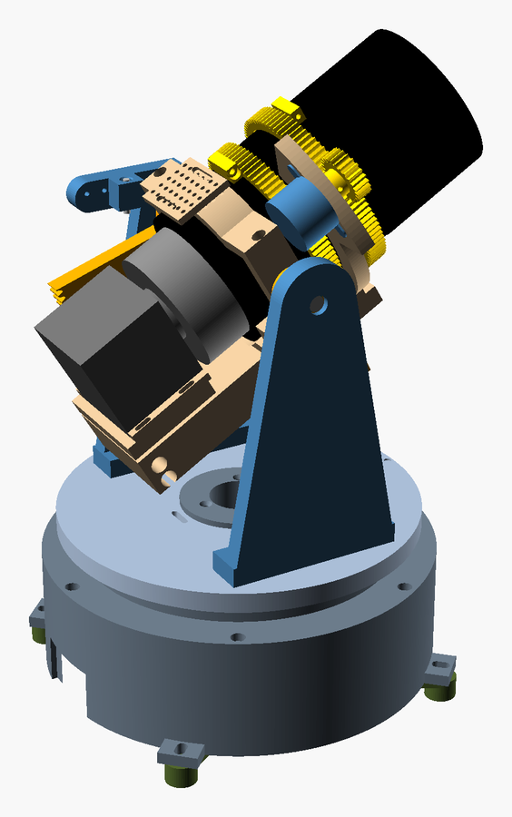
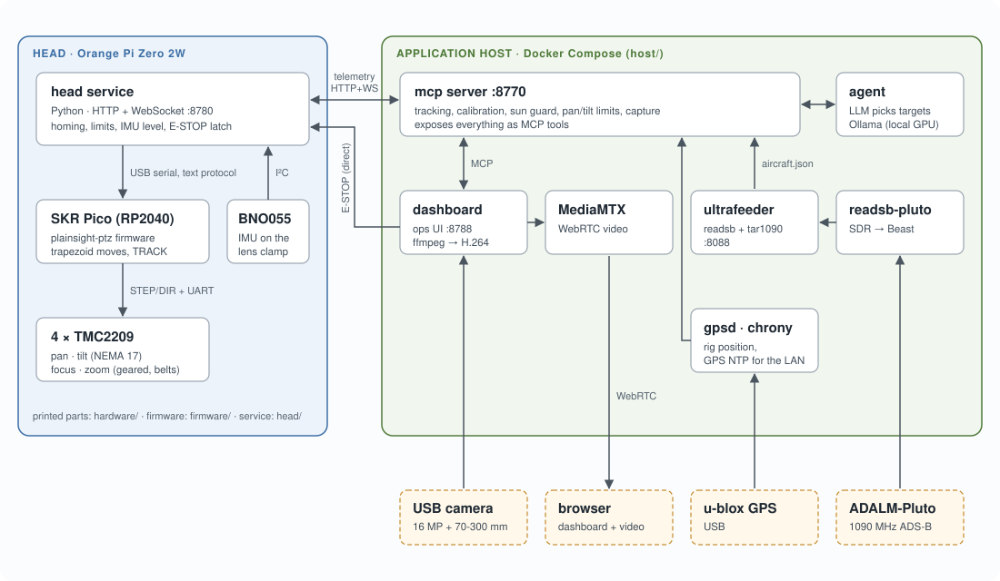
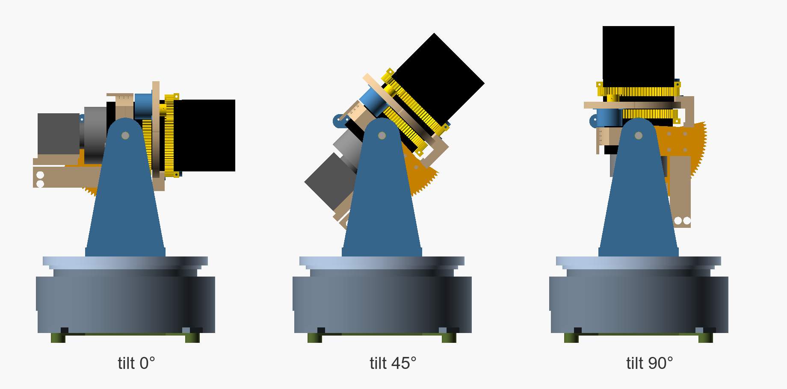
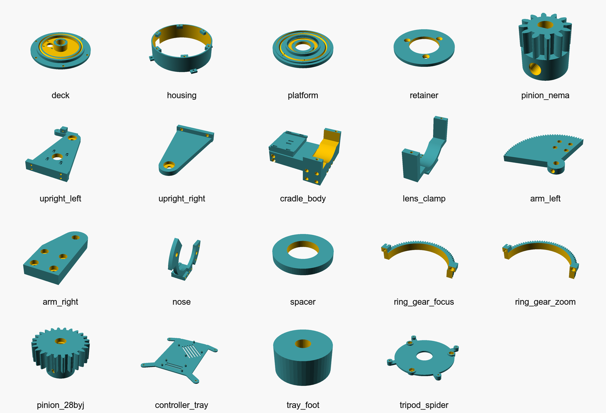

# plainsight-tracker



A roof-mounted pan/tilt camera head that points at aircraft. A small head
controller drives the motors and reports telemetry; an application host on the
LAN decides where to look (ADS-B, calibration, an LLM target chooser), streams
the camera and serves the operator dashboard.

Everything needed to build one is in this repo:

| Directory | What | Runs on |
|---|---|---|
| [`hardware/`](hardware/) | the 3D-printable head (OpenSCAD, STLs, BOM) | your printer |
| [`firmware/`](firmware/) | `plainsight-ptz` stepper firmware for a BTT SKR Pico | the head's motor board |
| [`head/`](head/) | head service: homing, limits, IMU, HTTP + WebSocket API | Orange Pi Zero 2W on the head |
| [`host/`](host/) | MCP server, LLM agent, dashboard, video, ADS-B | an x86 box with Docker |

<br clear="right">



## The head

A fork on a turntable: pan runs on a printed 140 mm ball race (67 steel balls), tilt
0–90° on steel trunnions in 608 bearings, focus and zoom by 1.5GT belts from two
small geared steppers to pulley rings clamped on the lens (ring gears and 28BYJ-48s
are the alternative). The tilt has a hard stop at exactly level, which doubles as the
calibration reference. Gearing is 76:12 on pan and 120:12 on tilt, so one 1/16
microstep is 0.018° and 0.011°. Details, print settings and the hardware list:
[hardware/README.md](hardware/README.md).



<details>
<summary>The 19 printed parts</summary>



</details>

## Two machines

```
                 LAN 192.168.4.0/22
                          |
  +-----------------------+-----------------------------+
  |                                                     |
  plainsight head (Orange Pi Zero 2W, 192.168.4.100)    application host (192.168.4.92)
  Armbian trixie, arm64, Docker                         Debian 13, x86_64, Docker 29 + Compose v5
  |                                                     |
  |  head/compose.yaml                                  |  compose.yaml (network_mode: host)
  |   +-- head  (Python, :8780 HTTP + WS)               |   +-- mcp           :8770  MCP server + tracking + capture
  |        |-- SKR Pico (plainsight-ptz) on USB serial  |   +-- agent                LLM target chooser (MCP client)
  |        +-- BNO055 IMU on I2C                        |   +-- dashboard     :8788  ops UI, camera ingest (ffmpeg NVENC/VAAPI -> MediaMTX)
  |                                                     |   +-- mediamtx      :8189/udp WebRTC; api/rtsp/whep on 127.0.0.1
  |                                                     |   +-- readsb-pluto         PlutoSDR -> Beast on 127.0.0.1:29005
  |                                                     |   +-- adsb          :8088  ultrafeeder (readsb + tar1090 + feeders)
  |                                                     |   +-- gpsd          :2947  u-blox 7 (loopback)
  |                                                     |   +-- chrony        :123   GPS-disciplined NTP for host + LAN
  |                                                     |   +-- ollama        :11434 local LLM on the RTX 2080 Ti (compose.gpu.yaml)
  |                                                     |   +-- detector             profile "vision", not built yet
  |                                                     |
  |                                                     |  USB camera (MJPG), ADALM-Pluto, u-blox 7 GPS
  |                                                     |  NVIDIA GPU (NVENC + Ollama) via compose.gpu.yaml
  |                                                     |  $PLAINSIGHT_DATA/{config,state,recordings,snapshots,adsb}
  |
  LLM: local Ollama (compose.gpu.yaml) or any OpenAI-compatible endpoint; optional InfluxDB on 192.168.4.11 for ultrafeeder stats
```

The host talks to the head only through the head API over the LAN. The head
never talks to the host; it serves. The dashboard's E-STOP latches the head
directly, without going through the MCP server.

## Repo layout

```
plainsight-tracker/
  README.md            this file
  compose.yaml         the application host stack
  compose.gpu.yaml     GPU overlay: NVENC for the camera, Ollama for the agent (needs the NVIDIA toolkit)
  .env.example         host settings (copy to .env on the host; never commit .env)
  hardware/            the printed head: config.scad, parts/, lib/, build/stl/, scripts/
  firmware/            plainsight-ptz for the SKR Pico (PlatformIO) + tools/ptz.py CLI + docs/PROTOCOL.md
  head/                the head controller: compose.yaml, Dockerfile, plainsight_head/, tests/, tools/
  host/                the host stack: one Node image for mcp/agent/dashboard
    src/               mcp/ agent/ dashboard/ shared/
    dashboard/public/  the dashboard UI (vanilla JS, no build). Layout since 2026-11-15:
                       full-bleed video; aircraft strip on top; E-STOP/Tools/Overlay top-right;
                       RIG (compass + tilt + pitch/roll gauges), TRIM and TRACKING widgets
                       left-centre (each hideable); the stick centred 3/4 down; one bottom line of
                       status chips, stick sensitivity and camera controls; radar under Tools.
                       See docs/superpowers/plans/2026-11-15-cockpit-hud-rework.md.
    mediamtx/          mediamtx.yml
    readsb-pluto/      readsb built with PlutoSDR support
    gpsd/              gpsd image
    chrony/            chrony image (NTP from gpsd shared memory)
    config.example.json
    test/              vitest suite
  docs/
    DEPLOY.md          install and update both machines
    HEAD-API.md        the head API reference, with JSON Schemas in head-api/
    BRING-UP.md        first-light checklist and measured results
    superpowers/       design spec and implementation plans
```

## Docs

- [docs/DEPLOY.md](docs/DEPLOY.md): prerequisites, head, host, verification,
  updating, logs, troubleshooting.
- [docs/HEAD-API.md](docs/HEAD-API.md): the head's HTTP and WebSocket API.
- [docs/BRING-UP.md](docs/BRING-UP.md): bring-up steps and what was measured.
- [host/README.md](host/README.md): host configuration keys, MCP tools, tracking,
  sun guard, dashboard.
- Design spec: [docs/superpowers/specs/2026-11-03-plainsight-tracker-design.md](docs/superpowers/specs/2026-11-03-plainsight-tracker-design.md).

## Quick start (host)

```bash
# on the host, after copying the repo (see docs/DEPLOY.md)
mkdir -p ~/plainsight-data/{config,state,recordings,snapshots,adsb}
cp -n .env.example .env            # set PLAINSIGHT_DATA, TB3_LLM_API_KEY
cp -n host/config.example.json ~/plainsight-data/config/config.json
docker compose up -d --build
```

Dashboard: `http://192.168.4.92:8788`. tar1090: `http://192.168.4.92:8088`.

## Development

```bash
cd host && npm ci && npm test      # Node 22
cd head && pytest                  # Python 3.13
```

Hardware: `hardware/scripts/build.sh` renders every STL and the preview PNGs with
OpenSCAD (tested with 2026.10; set `OPENSCAD=` if it is not at the macOS app path), and
`hardware/scripts/check_clearances.sh` runs the interference sweep. Firmware:
`cd firmware && pio run`.

## License

Software (everything outside `hardware/`) is MIT, see [LICENSE](LICENSE). The
head design in [`hardware/`](hardware/) is CERN-OHL-P v2, see
[hardware/LICENSE](hardware/LICENSE).
